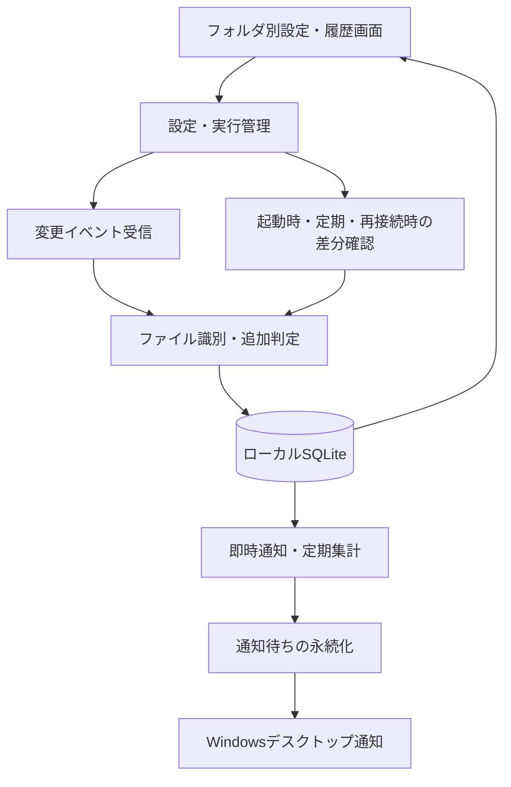

# フォルダ追加通知アプリ 実装方針

- 作成日：2026年10月15日
- 対応する要件定義：`requirements.md` バージョン0.2
- 状態：初版の実装を作成済み。Windows 11での検証結果と未検証範囲は`verification.md`に記載する。対象ファイルサーバーでの実機検証は未実施。
- 本書の構成・初期値は提案であり、要件定義の確定要件を変更するものではない。

## 1. 推奨構成

**C#／.NET 10 LTS／WPFでユーザー単位の常駐アプリを作り、変更イベントの受信と定期的な差分確認を併用する。設定・監視状態・通知対象はローカルのSQLiteに保存する。**

| 領域 | 採用候補 | 役割・選定理由 |
| --- | --- | --- |
| 言語・実行環境 | C#／.NET 10 LTS | Windows APIとの連携、ファイル操作、バックグラウンド処理を同じ言語で実装する。 |
| 設定UI | WPF／XAML | フォルダ一覧、個別設定、履歴をWindows専用のデスクトップUIとして作成する。 |
| UIの状態管理 | CommunityToolkit.Mvvm | 画面表示と監視処理を分離する。 |
| タスクトレイ | System.Windows.Forms.NotifyIcon | WPFアプリから利用し、常駐メニューを提供する。 |
| 変更イベント | System.IO.FileSystemWatcher | ファイル・ディレクトリの変化を素早く把握する。 |
| 差分確認 | Directory.EnumerateFileSystemEntries等＋状態比較 | 起動時、再接続時、定期確認でイベントの取りこぼしを補う。 |
| ファイル識別 | GetFileInformationByHandleEx等 | 利用可能な環境でファイルIDを取得し、名前変更と追加を区別する。 |
| データ保存 | SQLite／Microsoft.Data.Sqlite | 前回状態、追加履歴、通知予定、再送待ちをまとめて保存する。 |
| デスクトップ通知 | Windows App SDK／AppNotificationManager | Windowsの通知と、通知クリック時の処理を実装する。 |
| 自動起動 | ユーザーのRunキー | サインイン時に、設定画面を表示せず起動する。 |
| スケジュール | アプリ内の日時計算＋永続化 | 日次・週次・月次、月末、起動後の追いつき処理を制御する。 |
| 配布 | 必要な実行要素の同梱＋インストーラー | R-15を満たし、利用端末での前提ソフトウェアの手動導入を不要にする。ユーザー単位の導入を優先する。 |

WPFは.NETのWindows専用UIで、データバインディングや一覧表示に対応する。MVVM ToolkitはWPFでも使用できる。NotifyIconはタスクトレイ用の標準コンポーネントである。[WPF公式資料](https://learn.microsoft.com/en-us/dotnet/desktop/wpf/overview/)、[MVVM Toolkit公式資料](https://learn.microsoft.com/en-us/dotnet/communitytoolkit/mvvm/)、[NotifyIcon公式資料](https://learn.microsoft.com/en-us/dotnet/desktop/winforms/controls/notifyicon-component-windows-forms)

選定理由は今回の要件との適合性であり、他方式との性能比較を実測した結果ではない。

### 1.1 他の構成との比較

| 候補 | 今回の判断 |
| --- | --- |
| C#／WPF | 推奨。Windowsとの連携を中心に、設定UIと監視処理をまとめられる。 |
| C#／WinUI 3 | 候補。UIをWindows App SDKに統一したい場合に検討する。今回は設定中心のUIなのでWPFを優先する。 |
| Python＋GUI | 実装可能な代替案。既存のPython資産がない今回は、Windows通知やファイルID取得の連携をC#に集約する方針を優先する。 |
| Electron等のWeb UI＋常駐処理 | Web技術の既存資産を再利用する場合の候補。今回はWindows専用の新規アプリなので採用しない。 |
| Windowsサービス＋設定アプリ | サインイン前からの監視が必要になった場合に再検討する。現在の要件ではユーザーの常駐プロセス内にまとめる。 |

## 2. OSとランタイムの対応方針

.NET 10はLTSで、公式のサポート終了日は2028年11月14日。新規開発の基準とする。.NET 8／9は2026年11月10日にサポート終了予定のため、今回の開始時点で基準にはしない。実装時は.NET 10の最新安定パッチを使用する。[.NETサポートポリシー](https://dotnet.microsoft.com/en-us/platform/support/policy/dotnet-core)

Windows 10／11という名称だけで対応を確定せず、次の2つを区別して管理する。

- アプリを実際に起動・動作検証するOSのエディションとバージョン。
- MicrosoftがOSと.NETの組み合わせを公式にサポートする範囲。

調査時点の.NET公式資料では、Windows 10のサポート対象がLTSC／Enterpriseなどに限定されている。一般的なWindows 10 Home／Proも含めて無条件に公式サポート対象とは表記しない。利用端末のエディション・バージョンを確認して、Windows 11とともに互換性試験の対象を定める。[Windows版.NETの対応表](https://learn.microsoft.com/en-us/dotnet/core/install/windows)

初期のCPUアーキテクチャはx64を提案する。x86／Arm64が必要な場合は配布物と検証環境を追加する。

## 3. アプリ全体の構造

初期版は単一の常駐プロセスとし、内部でUI、監視、日時計算、保存、Windows連携を分離する。



| モジュール | 主な責務 |
| --- | --- |
| Desktop | WPF画面、タスクトレイ、UIスレッドへの状態反映。 |
| Monitoring | 監視先ごとのイベント受信、スキャン、再接続、追加判定。 |
| Scheduling | 次回実行日時、集計範囲、未実行分の処理。 |
| Persistence | SQLite操作、トランザクション、スキーマ更新。 |
| WindowsIntegration | 通知、自動起動、ファイルID、復帰検知、フォルダを開く操作。 |

当初はアプリ、UIから独立した処理、テストの3プロジェクト程度にまとめる。上記のモジュールすべてを別プロセス・別プロジェクトに分割する必要はない。

## 4. 監視の実装

### 4.1 変更イベントとスキャンを併用する理由

FileSystemWatcherにはバッファ超過によるイベント欠落があり、1回の操作で複数イベントが発生することもある。また、ファイル入りのフォルダが移動してきた場合、配下ファイルすべての追加イベントを期待できない。ネットワーク監視のバッファ上限も64KBである。[FileSystemWatcher公式資料](https://learn.microsoft.com/en-us/dotnet/api/system.io.filesystemwatcher?view=net-10.0)

このため、イベントを「確認すべき場所が変化した合図」として受け取り、実際の状態と保存済み情報を照合して追加を確定する。

### 4.2 通常時の処理

1. 原則として登録フォルダごとにFileSystemWatcherを作成し、IncludeSubdirectoriesを有効にする。
2. Created、Renamed、Deleted、Errorを内部状態の更新に利用する。更新・削除・名前変更の通知は出さなくても、内部では追跡する。
3. イベントコールバックではパスと種類をキューに入れるだけにし、ファイル列挙やDB更新を行わない。
4. 同じ場所への連続イベントを短時間でまとめ、対象ファイルまたは対象サブツリーを確認する。
5. フォルダ自体が追加・移動された場合は、配下も列挙して確認する。
6. ファイルの同一性と既知のパスを照合し、新規追加の候補を記録する。
7. 安定確認後に追加を確定し、即時通知の対象と定期集計の対象にする。

通常のイベント購読ではFileName／DirectoryNameを中心にして負荷を抑え、コピー中候補のサイズ・更新時刻は別途確認する案とする。例外的な保存操作を拾う必要性は検証で判断する。

### 4.3 差分確認を行うタイミング

| タイミング | 処理 |
| --- | --- |
| アプリ起動時 | 保存済みの状態と現在の状態を比較する。 |
| 定期 | イベント欠落や監視停止を補う。 |
| Watcherのエラー時 | 再作成と差分確認を予約する。 |
| ネットワーク再接続時 | 接続失敗前の状態と比較する。 |
| スリープ復帰時 | 接続状態、追加分、未実行スケジュールを確認する。 |
| 利用者の手動操作時 | 「今すぐ確認」で差分確認を行う。 |

全件確認の仮の初期値はローカル15分、共有フォルダ30分とする。イベントを利用できない監視先は別途短い間隔での確認を検討するが、即時性とサーバー負荷を実測して決める。これらの間隔は確定要件・性能保証ではない。

### 4.4 初回登録と再起動時の整合性

- 初回は基準取得中と表示し、基準取得完了までに確認したファイルは既存扱いにする案とする。この期間の追加も即時通知が必要かは、仕様確定時に確認する。
- 通常の再起動では、まずイベント受信を開始してから照合し、照合中のイベントを後で再確認する。
- スキャンは原子的なスナップショットではない。スキャン中に変更された場所を再確認し、単純に「走査結果でDBを全置換」しない。
- 監視先ごとに判定処理を直列化し、古いスキャン結果が新しいイベント状態を上書きすることを防ぐ。
- 初回の走査が途中で失敗した場合は基準取得完了にしない。
- 一部のサブフォルダが読み取れない場合は、その範囲の前回状態を保持する。列挙できなかったことを削除と判定しない。

## 5. ファイル追加・名前変更・移動の判定

### 5.1 パスだけの比較では不足する

アプリ停止中に`A.txt`が`B.txt`へ改名された場合、パス比較だけでは「Aが消えてBが追加された」と見える。R-07の「名前変更は通知しない」を満たすには、パスとは別の識別情報が必要になる。

利用可能な環境では、GetFileInformationByHandleExのFileIdInfoからボリューム識別情報とファイルIDを取得する。サーバーをまたいだ衝突を避けるため、アプリ内では監視先のストレージ識別範囲も含めて管理する。[GetFileInformationByHandleEx](https://learn.microsoft.com/en-us/windows/win32/api/winbase/nf-winbase-getfileinformationbyhandleex)、[FILE_ID_INFO](https://learn.microsoft.com/en-us/windows/win32/api/winbase/ns-winbase-file_id_info)

### 5.2 判定ルール案

| 状況 | 判定案 |
| --- | --- |
| 未知のファイルが監視範囲に現れた | 新規追加。 |
| 既知のファイルIDでパスだけが変わった | 名前変更または監視範囲内の移動。追加通知しない。 |
| 同一パス・同一IDでサイズや更新時刻が変わった | 内容更新。追加通知しない。 |
| 監視範囲内に存在していなかったファイルが外から入った | 同じボリュームからの移動でIDが維持されても新規追加。過去に見たIDという理由だけで除外しない。 |
| ファイルが削除され、後で同じパスに作成された | 新規追加を提案。ただし保存時の置き換え操作との区別が必要。 |
| 既存パスでファイルIDが変わった | 原子的な保存・置き換えの可能性があるため、ID変更だけで新規追加にしない。仕様と実測に基づき判定する。 |
| フォルダの名前変更 | 配下のパスを更新し、既存ファイルを一斉に追加扱いしない。 |

既知のファイルIDと現在の存在状態を分けて保存する。ファイルIDの再利用、ハードリンク、サーバーの切り替えなどもあるため、IDを永久に一意な識別子とは扱わない。[ファイル情報取得APIの注意点](https://learn.microsoft.com/en-us/windows/win32/api/fileapi/nf-fileapi-getfileinformationbyhandle)

### 5.3 共有フォルダでの成立条件

SMB経由のAPI対応だけで、すべてのNASやサーバーが安定したファイルIDを提供すると断定しない。再接続・サーバー再起動後も同一性を比較できるかを、実際の監視先で検証する。

ファイルIDが使えない環境では、稼働中のRenamedイベントで分かる名前変更は追跡できても、停止中の改名と新規追加の完全な区別は保証できない。サイズ・更新時刻・内容ハッシュによる推測も、コピーとの区別を保証しない。

したがって、R-07を満たす正式な対応環境は、この検証結果を条件に決定する。対応できないサーバーを無断で「パス比較のみ」に切り替えて要件を満たした扱いにはしない。必要であれば、対象環境の制限、仕様調整、サーバー側の変更記録を利用する構成のいずれかを検討する。

## 6. コピー中のファイルと通知の即時性

「即時」はファイルの追加が確定した後、次回の定期通知を待たず通知する意味とする。Createdイベントの受信と同時にコピー完了を保証する意味にはしない。

初期案は、サイズ・更新時刻を数秒おきに複数回確認し、変化が止まったら確定する方式とする。例えば2秒間隔で3回確認する。ゼロバイトのファイルも対象にする。

ただし、転送が一時停止しているだけの可能性があり、この方式はコピー完了の保証にはならない。通常はファイル全体を読み取らず、書き込みを妨げる排他ロックも使用しない。

厳密な完了判定が必要になった場合は、送り手が一時拡張子から正式名へ変更する運用、完了マーカーファイルなどを別途設計する。長時間安定しない候補は待機中としてUIに表示し、無期限の非表示状態を避ける。

## 7. 永続化と重複防止

### 7.1 SQLiteを採用する理由

設定だけならJSONでも足りるが、今回はファイル状態、複数スケジュールの集計位置、追加履歴、送信待ちを整合性を保って更新する必要がある。SQLiteに集約し、Microsoft.Data.Sqliteで操作する。[Microsoft.Data.Sqlite公式資料](https://learn.microsoft.com/en-us/dotnet/standard/data/sqlite/)

DBは監視先やファイルサーバーには置かず、利用者のローカルデータ領域、例えば`%LOCALAPPDATA%\FolderAdditionNotifier\state.db`に保存する。製品名とパスは仮称とする。

### 7.2 データ構造案

| テーブル | 主な情報 |
| --- | --- |
| WatchRoots | パス、表示名、有効状態、監視世代、接続状態、最終照合日時。 |
| FileEntries | 監視先、相対パス、ファイルID、現在の存在状態、サイズ、更新時刻、最終確認世代。 |
| PendingAdditions | 追加候補、初回検出日時、安定確認状態、最終確認日時。 |
| AdditionEvents | 確定順序ID、監視先、確定時のパス、検出日時、確定日時、検出元。 |
| Schedules | 曜日・日付・時刻、次回予定、前回の集計済み順序ID、設定世代。 |
| NotificationBatches | 通知方式、スケジュール、対象範囲、件数、処理状態、再試行情報。 |
| NotificationItems | 通知バッチと追加イベントの対応。 |
| SchemaVersions | DBスキーマのバージョン。 |

パスの大文字・小文字、UNCとドライブ文字の別名、末尾の区切り、長いパスを考慮する。文字列の単純な前方一致で親子フォルダを判定せず、パス境界を確認する。大文字・小文字を区別するディレクトリやリンク経由の重複は、対象環境の対応範囲として検証する。

### 7.3 トランザクションと送信待ち

- 状態更新と追加イベントの記録を同一トランザクションで行う。
- 即時通知と定期通知は別々のバッチを作り、即時通知済みという理由で定期集計から除外しない。
- 定期バッチの作成と集計位置の更新を同一トランザクションで行い、送信待ちの内容を確定する。
- OSへの通知処理はDBトランザクションの外で行う。送信失敗は同じバッチを再試行する。
- バッチ作成の一意制約で通常の重複作成を防ぐ。
- OS送信直後・DB更新前のクラッシュによる再送の可能性は残る。OS通知の表示まで含めた「必ず1回だけ」は保証せず、通知識別子による重複抑制をPoCで確認する。
- 記録する状態は「送信待ち／OSへの送信処理成功／失敗」などとし、利用者が見たことまで成功と見なさない。

SQLiteは単一の書き込み担当に集約し、UIスレッドではDB処理しない。Microsoft.Data.Sqliteの非同期メソッドは実際には同期実行となるため、メソッド名だけでUIの停止を回避できると考えない。WALの利用を検討する。[SQLiteの非同期処理の制約](https://learn.microsoft.com/en-us/dotnet/standard/data/sqlite/async)

## 8. スケジュール実装

日次・週次・月次の範囲では、型付きのルールから次回実行日時を計算する小さな実装を提案する。利用者にcron式を入力させず、曜日・日付・時刻のUIを提供する。

- 保存するのは利用者の日時ルール、タイムゾーン、次回予定、集計位置。
- 履歴の時刻はUTCで保存し、表示時にローカル時刻へ変換する。
- 固定秒数の繰り返しで「毎月」を再現せず、毎回カレンダー上の次回日時を計算する。
- 月末・存在しない日付の補正は要件定義の初期仕様案に従う。
- 待機中も一定間隔で現在時刻を再確認し、時刻変更・タイムゾーン変更・スリープ復帰に対応する。
- 夏時間のある環境では、存在しない時刻を次の有効時刻に補正し、重複する時刻は1回だけ実行する案とする。
- 過去の予定を逃した場合は、未集計分のバッチを1回作成し、次の将来日時に進める。
- 起動直後に期限を過ぎたスケジュールがある場合は、その監視先の照合が完了してから集計する。照合に失敗した場合は完了扱いで集計位置を進めない。
- 未確定の追加候補は、確定した後の次回集計へ回す。集計位置には確定順序IDを使用し、検出日時だけで区切って後から確定したファイルを落とさない。
- 0件の回もスケジュールの進行状態を保存するが、通知は作成しない。

複数スケジュールの集計位置は独立させる。例えば「毎日」と「毎月」を併用した場合、日次で報告したファイルも月次に含める。

設定変更時は新しい設定世代を作り、既存の送信待ちを勝手に削除しない。未集計分の引き継ぎ方は要件の未決定事項として残す。

## 9. Windows通知と常駐

### 9.1 通知

Windowsの公式案内では、WPFやパッケージ化されていないデスクトップアプリでもAppNotificationManagerを利用できる。UI全体をWinUI 3に変更する必要はない。[Windows通知APIの選択](https://learn.microsoft.com/en-us/windows/apps/develop/notifications/)

- 通知送信と、クリック時のアクティベーションを実装する。
- アプリがすでに動作している場合は、既存プロセスへ操作を渡す。
- 終了後の通知クリックでも、対象フォルダまたは履歴を開けることを配布形態ごとに検証する。
- 多重起動防止で2つ目のプロセスを即終了させ、クリック引数を失う実装を避ける。
- 表示名、追加件数、代表ファイル名を通知し、詳細は履歴に表示する。
- 追加が連続したときは数秒単位でまとめる。定期通知は原則としてフォルダ・スケジュールごとの通知にする。
- Windows側の設定によって画面表示されない場合も、追加履歴と送信処理結果を保存する。

App notificationsは管理者権限に昇格したアプリではサポートされないため、通常ユーザー権限で常駐させる。共有フォルダへの権限不足を、アプリの管理者実行で解決する設計にはしない。[通知の公式クイックスタート](https://learn.microsoft.com/en-us/windows/apps/develop/notifications/app-notifications/app-notifications-quickstart)

### 9.2 自動起動と終了

- パッケージ化しない初期構成では`HKCU\Software\Microsoft\Windows\CurrentVersion\Run`にアプリの起動先を登録する案とする。
- 自動起動用の引数で設定画面を表示せず開始する。
- 設定画面の閉じる操作ではウィンドウを非表示にする。WPFは明示終了までプロセスを維持する構成にする。
- トレイの終了操作では監視と保存を停止し、明示的に終了する。
- 自動起動の有効／無効を表示し、利用者や組織ポリシーによる無効化を尊重する。
- 通知クリック時の引数転送と組み合わせて、単一インスタンスを管理する。

Runキーは毎回のログオンに使用できる一方、実行順や即時実行は保証されない。自動起動時にネットワークがまだ使えない前提で再接続する。[Run／RunOnce公式資料](https://learn.microsoft.com/en-us/windows/win32/setupapi/run-and-runonce-registry-keys)

## 10. 共有フォルダ・大規模環境への対策

- 標準の保存パスはUNCを優先し、現在の利用者のWindows認証を利用する。
- 監視先ごとに接続状態と再試行間隔を持つ。再試行は徐々に間隔を広げ、上限を設ける。
- 状態は「監視中」「差分確認中」「ポーリングのみ」「一部読み取り不可」「接続不可」などを区別する。
- 共有フォルダへの並列アクセス数を制限し、同じサーバーへの走査が集中しないよう実行時刻を分散する。
- 初期実装はディレクトリ単位で列挙し、監視先ごとのファイル一覧をメモリ上で比較してからSQLiteへ保存する。大規模環境では、DB上での差分比較や段階的な反映への変更を検討する。無制限の規模に対応したとするものではない。
- イベントキューは上限を持つ。あふれた場合は当該フォルダに再照合が必要な印を残す。
- キューの印だけで、スキャンの間に追加・削除された短命ファイルまで復元できるとは保証しない。
- ネットワークI/Oのキャンセルが常に即座に効くとは仮定しない。共有先ごとの未完了処理数を制限し、1つの接続待ちでUIやほかの監視先を停止させない。
- 実環境でOS側I/Oが長時間戻らず支障が出る場合は、共有先の走査を別プロセスへ分離する案を検討する。
- ジャンクションやシンボリックリンクは、再帰ループや範囲外監視を避けるため初期案では追跡しない。通常のサブフォルダとは異なる扱いとしてUI・仕様に明記する。
- 親子フォルダの重複登録は、初期案では警告して登録を止める。同一ストレージの別名パスによる重複は追加検証する。これは未確定事項への提案である。

## 11. 配布と開発環境

### 11.1 配布

R-15により、前提ソフトウェアの事前導入を不要とすることを配布の必須条件とする。利用者の操作はアプリの配布物を導入して起動する範囲に収める。

初期案は、固定されたユーザー領域へインストールする通常のデスクトップアプリとする。.NETとWindows App SDKの両方を自己完結型にし、必要なファイルを配布物へ含める。最初から単一EXE化にはこだわらない。

| 要素 | 利用端末での扱い |
| --- | --- |
| Node.js／npm | 採用構成では使用しない。事前導入不要。 |
| Python | 採用構成では使用しない。事前導入不要。 |
| .NETランタイム | 自己完結型としてアプリに同梱する。グローバル導入を前提にしない。 |
| Windows App Runtime | Windows App SDKの自己完結型設定で必要部分を同梱する。 |
| SQLite | .NET側のライブラリと、対象アーキテクチャのネイティブDLLを同梱する。DBサーバーの導入は不要。 |
| .NET SDK／Visual Studio／Windows SDK | 開発・ビルド側だけで使用し、利用端末には要求しない。 |
| Visual C++等のネイティブ依存 | 選定バージョンの依存関係を確認する。必要なら再頒布条件に従い同梱または配布物内のセットアップで処理し、利用者の別途手動導入を前提にしない。 |

自己完結型は利用端末の.NET事前インストールを不要にできるが、同梱ランタイムの更新はアプリの再配布で行う必要がある。[.NETの配布方式](https://learn.microsoft.com/en-us/dotnet/core/deploying/)

Windows App SDKは既定では共有ランタイムに依存するため、.NET側の自己完結型設定に加えて`WindowsAppSDKSelfContained=true`を指定する。公式資料では、AppNotificationManagerはプッシュ通知用の追加Singletonパッケージを必要としない。今回利用するのはローカルのデスクトップ通知とする。[Windows App SDKの自己完結型配布](https://learn.microsoft.com/en-us/windows/apps/package-and-deploy/self-contained-deploy/deploy-self-contained-apps)

パッケージ化しないx64構成における主要な設定例を以下に示す。完全なプロジェクトファイルではなく、実装時にSDKのバージョンと初期化方法を確認する。

```xml
<PropertyGroup>
  <RuntimeIdentifier>win-x64</RuntimeIdentifier>
  <SelfContained>true</SelfContained>
  <WindowsAppSDKSelfContained>true</WindowsAppSDKSelfContained>
  <WindowsPackageType>None</WindowsPackageType>
</PropertyGroup>
```

自己完結型という指定だけで、OSに含まれないすべてのネイティブ依存まで解決したと判断しない。Windows App SDKの初期化、通知登録・解除、SQLiteのネイティブDLLを含む配布ファイルの完全性を確認する。Visual C++再頒布可能パッケージなどが必要になる構成もあるため、依存関係の一覧を作成し、クリーン環境の試験で不足を検出する。[Windows App SDKの依存関係](https://learn.microsoft.com/en-us/windows/apps/windows-app-sdk/deployment-architecture)

R-15は利用者による事前準備を不要にする要件であり、「フォルダをコピーするだけ」「単一EXE」「管理者権限を一切使用しない」までを確定したものではない。ユーザー単位の導入を優先するが、セットアップ時の権限要否は依存解決方式の検証で決める。常駐プロセス自体は通常ユーザー権限で動作させる。

外部から依存ファイルを追加ダウンロードしない配布を初期方針とし、インターネットを遮断した検証環境でも導入から通知まで確認する。共有フォルダ利用に必要な社内ネットワーク接続とは区別する。

MSIXを採用する場合は、自動起動の登録、通知アクティベーション、更新・アンインストールをパッケージ用の構成へ切り替える。配布形式は初期PoC後に決定する。

### 11.2 現在の作業環境

当初の作業端末には.NET 6／8のランタイムがあり、.NET SDKは未インストールだった。実装時に.NET 10 SDK 10.0.402を作業フォルダの`.tools/dotnet`に準備した。利用端末にはこのSDKを要求しない。

検証では`--data-dir`と`--no-startup`を用いて通常の設定データと分離し、自動起動は登録しない。Windows通知の検証に伴う通知アプリの登録は行う。

## 12. 実装順序と検証

### フェーズ1：成立条件の検証

完成UIより先に、次の技術PoCを行う。

1. Windows 10／11の対象バージョンで、通知表示・通知クリック・終了後のクリック起動を確認する。
2. ローカルと実際の共有サーバーで、FileSystemWatcherと再帰走査を確認する。
3. 名前変更・移動・再接続・サーバー再起動前後のファイルIDを確認する。
4. Excel等による保存時の置き換えを含め、更新が追加通知にならないことを確認する。
5. Node.js、Python、.NET、Windows App Runtime、開発用SDKを別途導入していない対象Windowsのクリーン環境で、配布物だけから導入・起動する。追加ダウンロードを防ぐためインターネットも遮断し、設定、監視、通知表示、終了後の通知クリック、サインイン後の自動起動まで確認する。Windows標準搭載コンポーネントは除去しない。

完了条件は、通知方式と配布方式が成立し、R-07を満たすストレージ環境を明示できること、およびR-15／A-13の事前導入不要を実機確認できること。ファイルIDが使えない環境の扱いや、実行依存の不足を未解決のまま正式対応としない。

### フェーズ2：監視と永続化

- 基準取得、追加候補、追加確定、再起動後の照合。
- ネットワーク切断、部分的なアクセス拒否、イベント欠落からの回復。
- DBのトランザクションと追加イベントの重複抑制。

### フェーズ3：常駐と即時通知

- タスクトレイ、画面を閉じた後の常駐、自動起動、明示終了。
- 通知バッチ、再試行、通知クリックの既存プロセスへの引き継ぎ。

### フェーズ4：スケジュールと設定UI

- フォルダごとの即時／定期／両方の設定。
- 毎日・毎週・毎月、複数スケジュール、月末処理。
- 起動後のまとめ通知、履歴表示、接続状態の表示。

### フェーズ5：負荷と配布の確認

- 1万件・10万件など段階的なデータで、初回走査時間・再走査時間・メモリ・ネットワーク負荷を測定する。これらは試験条件であり、現時点の対応上限ではない。
- 大量追加、フォルダごとの一括移動、コピー中断、接続断と復旧を確認する。
- 複数フォルダ同時動作、アプリ強制終了後の回復を確認する。
- 新規インストール、更新、アンインストールを確認する。

### 自動テストで優先する項目

- 名前変更と追加の判定、監視範囲外からの移動、同名ファイルの再追加。
- 月末、うるう年、時刻変更、未実行分の集約。
- 即時通知が定期集計対象を消費しないこと。
- 安定確認が遅れて確定したファイルが、集計位置の更新で取りこぼされないこと。
- 部分的な走査失敗で、既存状態を消さないこと。
- 通知バッチ作成途中の失敗・再起動で、不整合が生じないこと。

Windows通知、サインイン、実際のSMBサーバーの挙動は、単体テストに加えて実機で確認する。

## 13. 検討結果と残る確認事項

今回の要件は、ユーザー単位のWindows常駐アプリとして実装する方針が妥当と判断する。主要な構成はC#／WPF、イベントと差分確認の併用、SQLite、Windows App SDKによる通知である。

設計上の最優先事項は、次の3点。

1. **実際のファイルサーバーで、停止中の名前変更を追加と区別できるか。** できない環境では正式対応の範囲または要件調整が必要。
2. **対象となるWindows 10のエディション・バージョン。** 互換性試験と公式サポート範囲を分けて明示する。
3. **監視規模。** フォルダ数、合計ファイル数、1日の追加件数に合わせて走査間隔と並列数を調整する。

この3点を確認しながらフェーズ1を進め、その結果に基づいて実装構成・配布形式・性能目標を確定する。

## 14. 初期実装で具体化した事項

- 配布物は、ランタイム同梱のセットアップEXEと、すべて展開して使用するZIPの2種類を生成する。
- セットアップはユーザー単位のインストール、スタートメニューの登録、自動起動の選択、Windowsのアプリ一覧からのアンインストールに対応する。
- ファイル一覧・安定確認中の候補は、SQLiteの`snapshots`テーブル内に監視先単位のJSONとして保存する。追加イベント、スケジュール状態、通知バッチは別テーブルで管理する。4.2および7.2の分割案を簡略化した構成である。
- ローカル系とUNC共有の全件走査は、それぞれ最大2件を同時実行する。初期実装のイベント受信は、個別イベントを蓄積する代わりに変更世代のカウンターで再照合を予約する。
- 新しい定期通知予定の集計開始位置は保存時点とし、それより後に確定した追加分を対象にする。既存予定の日時変更では未集計分を保持する。
- 既存パスの置き換えは更新として扱い、一度削除が確認された後の再追加は新規扱いとする。
- 親子を含む範囲の重複登録は禁止する。再解析ポイントは追跡しない。
- 履歴は最新1,000件を画面で表示し、DB内の履歴は自動削除しない。保存期間の設定は今後の拡張事項とする。
- 通知登録・表示・クリック時の処理はWindows App SDKに接続する。OSへの送信成功と、実際に利用者が見たことを区別する。
- OSに含まれないCRTへの未同梱の静的インポートがないことを、配布DLLの検査で確認する。これだけで、未検証OSや遅延的な機能呼び出しまで含む完全な互換性を保証しない。

起動方法、保存先、現時点の制約は`README.md`、実施した試験は`verification.md`を正とする。
